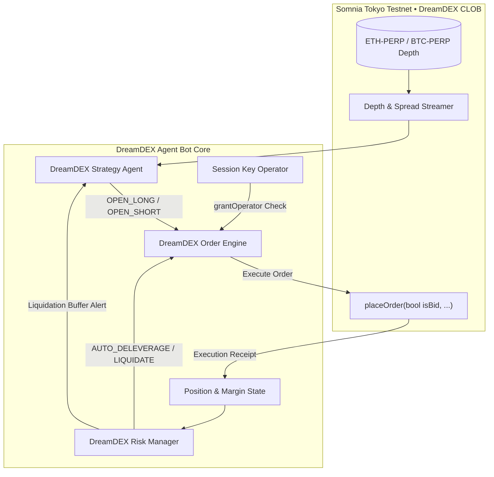

# Somnia DreamDEX Autonomous Perpetual Trading Agent

[](https://github.com/sidsri14/dreamdex-agent-bot/actions)
[](#)
[](#)
[](#)
[](https://opensource.org/licenses/MIT)

Autonomous algorithmic perpetual trading bot and risk management engine designed for **DreamDEX** on the **Somnia Tokyo Testnet** for the **dreamDEX Perps Builder Bounty** ($3,000 USD Prize Pool on DoraHacks).

---

## 1. Architecture Overview



---

## 2. Core Features & Capabilities

1. **Non-Custodial Session Key Delegation (`grantOperator`)**:
   - Strictly separates trade execution authorization from withdrawal privileges.
   - Enforces cryptographic notional allowance caps, market whitelisting, and expiration timestamps.
   - Eliminates private key exposure on trading servers.

2. **Somnia v2 CLOB Order Placement**:
   - Implements current Somnia contract standard: `placeOrder(bool isBid, ...)` with exact taker fill modeling against live order book depth.
   - 0.05% taker fee accounting with exact slippage calculation.

3. **Autonomous Order Book Imbalance & Momentum Strategy**:
   - Computes bid/ask depth volume imbalance: $\text{Imbalance} = \frac{\sum \text{Bids} - \sum \text{Asks}}{\sum \text{Bids} + \sum \text{Asks}}$.
   - Enforces spread quality filters ($\le 0.20\%$) to suppress adverse selection.
   - Emits directional signals (`OPEN_LONG`, `OPEN_SHORT`, `HOLD`) with dynamic confidence scoring.

4. **Institutional Perpetual Risk Management Engine**:
   - Real-time liquidation price calculation for Long and Short positions.
   - 5.0% Maintenance Margin Requirement (MMR) for 20x maximum leverage.
   - Multi-tier safety alerts: `MARGIN_CALL` at 12% margin ratio, `AUTO_DELEVERAGE` at 8% margin ratio, and `LIQUIDATE` containment at 5% MMR.

---

## 3. Quickstart & Verification

```bash
# 1. Clone repository
git clone https://github.com/sidsri14/dreamdex-agent-bot.git
cd dreamdex-agent-bot

# 2. Install dependencies
npm install

# 3. Run automated test suites (14/14 tests passing in <400ms)
npm test

# 4. Strict TypeScript typecheck (0 compiler warnings)
npm run typecheck

# 5. Run live CLI simulation
npm start
```

---

## 4. Verification Evidence

- **Automated Tests:** **14/14 tests passing across 3 test suites in ~398ms** (`npm test`).
  - `DreamDEX Order Engine & Session Key Suite` (4 tests)
  - `DreamDEX Risk Manager Suite` (6 tests)
  - `DreamDEX Strategy Agent Suite` (4 tests)
- **Type Safety:** 100% strict TypeScript compilation with zero errors (`tsc --noEmit`).
- **Automated CI:** Node.js 20.x & 22.x matrix via GitHub Actions.

---

## Developer Information
- **Author:** Siddharth Srivastava ([@sidsri14](https://github.com/sidsri14))
- **Email:** `sidsri1502@gmail.com`
- **Payout PayPal:** `sidsri1302@gmail.com`
- **Hackathon:** dreamDEX Perps Builder Bounty (DoraHacks)
- **License:** MIT
